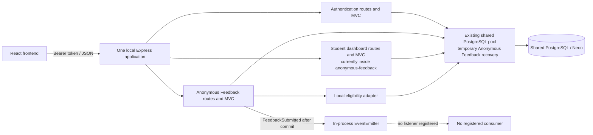
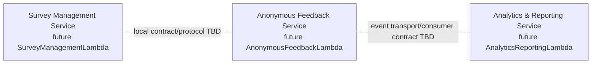

# Architecture: Current Local Application and Future Boundaries

## Current local implementation

This describes local source structure only. Authentication and Anonymous Feedback currently use the existing shared pool configured by `DATABASE_URL`. This is a temporary recovery arrangement while dedicated-role separation is paused. It does not assert separate processes, deployed Lambdas, or live Neon connectivity.

Student submissions return a generic confirmation. The student-only My Submissions page reads participation metadata using the authenticated JWT identity and joins only surveys/course/semester catalog data; it does not read individual answers. Student response edit, withdrawal, and delete operations are not exposed. The active submission and metadata paths do not use the HMAC secret, ownership table, or ownership lock function. The historical migration file is retained but is not required for current application behavior; if applied in Neon, any table/function cleanup requires a separately reviewed migration and must not delete existing data implicitly. Anonymous Feedback shares the application's database role and pool; database-principal isolation is not active. All code remains in one Express process.

## Future Lambda boundaries (deployment not implemented)

Only the three intended boundaries are established by project clarification. Transport, gateway, service authentication, retries, timeouts and deployment wiring remain TBD; no AWS service is represented as currently connected.

